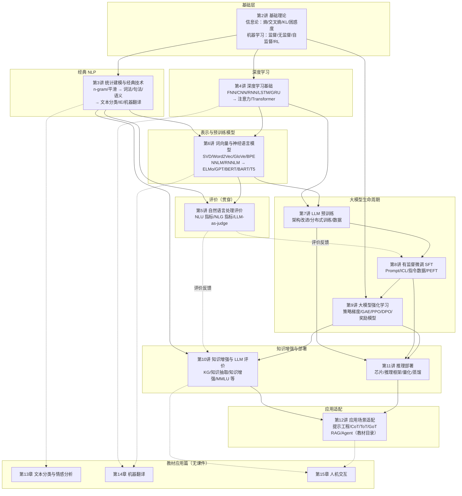
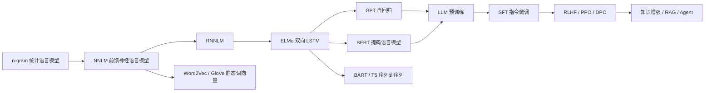

# 自然语言处理课程知识图谱

> **依据**：HIT-NLP 课件（第 2–12 讲）与《101 计划·自然语言处理》预览版目录  
> **范围**：忽略第 1 讲绪论；本目录第 12 讲课件仅展开 12.1 提示工程，12.2 RAG / 12.3 智能体仅见教材目录；第 13–15 章暂无课件  
> **整理日期**：2026-10-20

## 目录

- [1. 课程主线](#1-课程主线)
- [2. 知识图谱总览](#2-知识图谱总览)
- [3. 分讲知识定位](#3-分讲知识定位)
- [4. 纵向概念链](#4-纵向概念链)
- [5. 关键交叉连接](#5-关键交叉连接)
- [6. 教材应用篇](#6-教材应用篇)
- [7. 关键词速查](#7-关键词速查)
- [8. 按目标复习的路径](#8-按目标复习的路径)

---

## 1. 课程主线

课程按 NLP 技术范式的演进组织：

1. **统计 NLP**：用 n-gram、马尔可夫假设和平滑方法建模语言，用规则/统计方法完成分词、词性标注、句法分析等任务。
2. **深度学习 NLP**：用神经网络自动学习表示，RNN/LSTM 处理序列，注意力与 Transformer 解决长依赖和并行建模问题。
3. **预训练模型**：从静态词向量到 ELMo/GPT/BERT/BART/T5，再到 decoder-only 大语言模型。
4. **大模型三阶段**：预训练（第 7 讲）→ 有监督微调 SFT（第 8 讲）→ 人类反馈强化学习 RLHF（第 9 讲）。
5. **增强、部署与应用**：知识增强与 LLM 评价（第 10 讲）、推理部署（第 11 讲）、应用场景适配（第 12 讲）。

贯穿全课的四条支撑线：

- **评价线**：第 5 讲，且贯穿所有模型与任务。
- **数据线**：标注数据 → 无标注预训练语料 → 指令数据 → 偏好数据 → 外部知识库。
- **算力与效率线**：分布式训练 → PEFT → 量化/蒸馏 → 推理框架。
- **基础理论线**：信息论与机器学习（第 2 讲）。

---

## 2. 知识图谱总览

### 2.1 模块依赖图

> 实线表示主要的知识依赖，虚线表示评价反馈或教材延伸关系。

### 2.2 语言模型主线

> 如果 Markdown 查看器不支持 Mermaid，可直接阅读第 3 节的模块表和第 4 节的概念链。

---

## 3. 分讲知识定位

| 讲次 | 模块 | 核心概念 | 图谱关系 |
|---|---|---|---|
| 2 | 基础理论 | 熵、联合熵、条件熵、交叉熵、KL 散度、困惑度；有监督/无监督/自监督/强化学习 | 为第 3 讲提供概率与语言模型评价工具；为第 4/6/7/8 讲提供交叉熵损失；为第 9 讲提供 RL 基础 |
| 3 | 统计建模与经典技术 | n-gram、马尔可夫假设、数据稀疏；加一/Good-Turing/Kneser-Ney 平滑、回退与插值；分词（最大匹配）、NER（规则/统计/HMM/CRF/MaxEnt）、词性标注、句法分析（短语结构/依存/PCFG）、语义角色标注；文本分类、信息抽取、机器翻译 | 第 6 讲 NNLM 正是为了解决 n-gram 的数据稀疏与泛化问题；IE 是第 10 讲知识抽取的前身；MT/分类任务在第 5 讲有对应评价 |
| 4 | 深度学习基础 | 神经元、感知机、激活函数；FNN/BP/损失函数；CNN（LeNet/AlexNet/VGG/GoogLeNet/ResNet）；RNN/LSTM/GRU；注意力、自注意力、多头注意力；Transformer | 为第 6 讲 ELMo（BiLSTM）、GPT/BERT（Transformer）、BART/T5（Seq2Seq Transformer）提供网络组件；Transformer 直接进入第 7 讲 LLM 架构 |
| 5 | 评价 | NLU：准确率、混淆矩阵、P/R/F、宏平均/微平均、ROC；回归：MAE/RMSE/Pearson/Spearman；NLG：BLEU/ROUGE/BERTScore/COMET/LLM-as-judge | 用第 2 讲的熵与困惑度；评价第 3/4/6 讲的任务与模型；第 8 讲用 ROUGE-L 过滤 Self-Instruct 数据；第 10 讲延伸为 MMLU/AlpacaEval/Arena |
| 6 | 词向量与神经语言模型 | 分布式假设；共现矩阵+SVD；Word2Vec（Skip-Gram/CBOW/负采样）；GloVe；BPE 子词；NNLM/RNNLM；ELMo/GPT/BERT/BART/T5 | 第 3 讲 n-gram 的神经替代；第 7 讲 LLM 的直接前身；词向量与 BPE 也支撑第 5 讲 BERTScore 和第 12 讲 RAG 检索 |
| 7 | LLM 预训练 | 三阶段框架；Transformer 架构改进（位置编码、RMSNorm、MHA/MQA/GQA）；分布式训练（混合精度、FlashAttention、梯度累加、重计算、DP/TP/PP/SP/混合并行）；数据来源、配比、过滤、合成 | 承接第 4/6 讲；为第 8/9 讲提供基座模型，为第 11 讲提供待部署模型 |
| 8 | 有监督微调 | Prompt Learning、上下文学习 ICL；SFT 目标与指令-响应数据；LIMA、Self-Instruct；全量微调、PEFT（Prefix/Adapter/LoRA/AdaLoRA/QLoRA）；特定能力 SFT | 从第 7 讲基座出发；SFT 模型是第 9 讲 RLHF 的初始策略；LoRA/QLoRA 与第 11 讲量化部署相连；Prompt/ICL 是第 12 讲提示工程的前身 |
| 9 | 大模型强化学习 | 策略梯度、轨迹与回报；RLHF 与 3H 原则；GAE；PPO（重要性采样、KL/裁剪）；DPO；奖励模型（偏好数据收集、训练、开源数据） | 以第 8 讲 SFT 模型为起点；应用第 2 讲的 RL；奖励模型与对齐评价连接到第 10 讲；Agent 的规划/学习可视为其思想延伸 |
| 10 | 知识增强与模型评价 | 知识表示（一阶逻辑/语义网络/RDF/RDFS/OWL）；知识图谱构建（schema、抽取、补全、Neo4j 存储）；知识抽取（实体/关系/事件；非结构化/结构化/半结构化）；知识增强（预训练内化、推理外用 RAG/CoT/ICL）；LLM 评价体系；MMLU/AlpacaEval/Chatbot Arena | 第 3 讲 IE 的深化；第 6/7 讲模型与知识的结合；第 5 讲评价在 LLM 时代的扩展；RAG 直接通向第 12 讲 |
| 11 | 推理部署 | CPU/GPU/TPU/NPU；vLLM/PagedAttention、TGI、TensorRT-LLM、DeepSpeed-MII、llama.cpp；量化（逐层/逐通道/逐组；QAT/QAF/PTQ；LLM.int8/GPTQ/SmoothQuant/SpQR/AWQ）；蒸馏（MiniLLM/GKD/涌现能力） | 承接第 7 讲模型与第 8 讲 PEFT；是第 12 讲应用落地的工程前提 |
| 12 | 应用场景适配 | 提示工程：离散/连续提示、P-Tuning、APO/APE、CoT/Zero-shot CoT/Auto-CoT/Self-consistency、ToT、GoT、慢思考；RAG、Agent（教材目录） | 第 8 讲 Prompt/ICL 的延伸；CoT 与第 9 讲推理/强化微调相关；RAG 与第 10 讲知识增强相关；Agent 与工具使用、规划相关 |

---

## 4. 纵向概念链

| 概念链 | 演进路径 |
|---|---|
| **语言建模链** | n-gram → NNLM → RNNLM → ELMo（双向上下文）→ GPT（自回归）/ BERT（掩码）/ BART、T5（序列到序列）→ LLM 预训练 → SFT/RLHF → CoT/RAG/Agent |
| **表示链** | 独热表示 → 共现矩阵+SVD → Word2Vec/GloVe → BPE 子词 → 上下文词向量（ELMo/GPT/BERT）→ LLM 词元表示 → 检索向量（RAG） |
| **架构链** | 感知机 → FNN → CNN/RNN/LSTM/GRU → 注意力 → Transformer → GPT/BERT → LLM（RoPE、RMSNorm、SwiGLU、GQA）→ 推理优化（MQA/GQA、PagedAttention） |
| **学习范式与数据链** | 监督学习 → 无监督学习 → 自监督预训练 → 指令微调（SFT）→ 偏好学习（RLHF/PPO/DPO）→ 上下文学习/提示/RAG/Agent；数据从标注数据 → 无标注语料 → 指令-响应对 → 偏好对 → 外部知识库 |
| **评价链** | 交叉熵/困惑度 → 分类与回归指标 → BLEU/ROUGE → BERTScore/COMET → LLM-as-judge → MMLU/AlpacaEval/Chatbot Arena；评价同时反哺训练：损失函数选择、数据过滤、模型选择 |
| **效率与工程链** | BP/GPU → 混合精度/FlashAttention/梯度累加/重计算 → 数据并行/张量并行/流水线并行/参数切片 → PEFT（LoRA/QLoRA）→ 量化/蒸馏 → 推理框架与芯片 |

### 4.1 补充说明

- **语言建模链**解释了“为什么会有第 6 讲”：n-gram 的平滑只能缓解稀疏，神经网络语言模型通过分布式表示获得泛化能力，预训练则进一步把“语言建模”变成通用能力来源。
- **表示链**和**架构链**是并行的两条技术路线：一条解决“词/句子怎么表示”，一条解决“用什么网络建模上下文”，二者在第 6 讲汇合为预训练语言模型。
- **学习范式与数据链**是理解第 7–9 讲的关键：预训练用无标注语料，SFT 用指令-响应对，RLHF 用偏好对，RAG 用外部知识库；每一步都在改变“监督信号从哪来”。
- **评价链**不只是第 5 讲的内容，它同时是训练目标（交叉熵）、数据过滤工具（ROUGE-L）和模型选择依据（MMLU/AlpacaEval/Arena）。

---

## 5. 关键交叉连接

1. **数据稀疏**：第 3 讲 n-gram 平滑要解决的问题，在第 6 讲被“分布式表示 + 神经网络语言模型”用泛化能力解决，并进一步走向第 7 讲的大规模预训练。
2. **交叉熵**：第 2 讲信息论 → 第 4/6/7/8 讲的训练损失 → 第 2/5 讲的困惑度与生成评价，是整个课程中连接最多的一条边。
3. **注意力机制**：RNN 的长依赖问题 → 注意力 → Transformer → 预训练语言模型 → LLM 的长上下文与推理，是架构演进的核心枢纽。
4. **SFT**：预训练与对齐之间的桥梁；没有 SFT 的指令跟随能力，RLHF 就缺少合适的初始策略；LoRA/QLoRA 又把这条线接到部署。
5. **知识/检索**：第 3 讲信息抽取 → 第 10 讲知识图谱与知识增强 → 第 12 讲 RAG/Agent，形成“从文本中抽知识，再把知识喂回模型”的闭环。
6. **评价反馈**：第 5 讲的指标不仅用于“打分”，还反向影响第 8 讲的指令数据过滤和第 10 讲的 LLM 评测基准。
7. **压缩与高效微调**：第 8 讲 LoRA/QLoRA → 第 11 讲量化/蒸馏/推理框架，是“训练—部署”之间最直接的一条工程边。

---

## 6. 教材应用篇

101 目录中的第 13–15 章，是把前面的模型与方法落到具体任务。本目录暂无对应课件，以下仅按教材目录标注关系。

| 教材章节 | 主要内容 | 与本课程的关系 |
|---|---|---|
| 第 13 章 文本分类与情感分析 | 统计文本分类、深度神经网络文本分类、文本聚类；词级/句子级/文档级/属性级情感分析 | 展开第 3 讲文本分类；使用第 4/6 讲模型；使用第 5 讲评价指标 |
| 第 14 章 机器翻译 | 机器翻译概述与发展；RNN 编码器-解码器；Transformer NMT；大模型时代的机器翻译 | 展开第 3 讲 MT 概述；结合第 4 讲 RNN/Transformer、第 6 讲 Seq2Seq/预训练模型 |
| 第 15 章 人机交互 | 图灵测试、问答系统、阅读理解、对话系统、角色扮演；基于大语言模型的人机交互 | 结合第 10 讲知识增强、第 12 讲提示工程/RAG/Agent |

---

## 7. 关键词速查

| 关键词 | 出处 |
|---|---|
| 熵 / 交叉熵 / KL 散度 / 困惑度 | 第 2 讲 |
| 有监督 / 无监督 / 自监督 / 强化学习 | 第 2 讲 |
| n-gram / 马尔可夫假设 / 数据平滑 | 第 3 讲 |
| 分词 / NER / 词性标注 | 第 3 讲 |
| 句法分析 / PCFG / 依存句法 | 第 3 讲 |
| 语义角色标注 | 第 3 讲 |
| 文本分类 / 信息抽取 / 机器翻译 | 第 3 讲 |
| 感知机 / BP / CNN / RNN / LSTM / GRU | 第 4 讲 |
| 注意力 / 自注意力 / Transformer | 第 4 讲 |
| 准确率 / P-R-F / 宏平均 / 微平均 / ROC | 第 5 讲 |
| MAE / RMSE / Pearson / Spearman | 第 5 讲 |
| BLEU / ROUGE / BERTScore / COMET | 第 5 讲 |
| 分布式表示 / Word2Vec / GloVe / BPE | 第 6 讲 |
| NNLM / RNNLM / ELMo / GPT / BERT / BART / T5 | 第 6 讲 |
| LLM 预训练 / 分布式训练 / MQA / GQA | 第 7 讲 |
| SFT / 指令数据 / LIMA / Self-Instruct / LoRA / QLoRA | 第 8 讲 |
| RLHF / 策略梯度 / GAE / PPO / DPO / 奖励模型 | 第 9 讲 |
| 知识图谱 / RDF / RDFS / OWL / 知识抽取 | 第 10 讲 |
| 知识增强 / MMLU / AlpacaEval / Chatbot Arena | 第 10 讲 |
| 芯片 / vLLM / TGI / TensorRT-LLM / 量化 / 蒸馏 | 第 11 讲 |
| 提示工程 / APO / APE / CoT / ToT / GoT | 第 12 讲 |

---

## 8. 按目标复习的路径

- **打基础**：第 2 讲 → 第 3 讲 → 第 4 讲 → 第 6 讲。先掌握信息论/机器学习，再看经典 NLP 如何被神经网络替代。
- **大模型主线**：第 6 讲 → 第 7 讲 → 第 8 讲 → 第 9 讲 → 第 10 讲 → 第 12 讲。重点是“预训练 → SFT → RLHF → 知识增强/应用”的能力递进。
- **评价专题**：第 2 讲（熵/困惑度）→ 第 5 讲（NLU/NLG 指标）→ 第 10 讲（LLM 评测基准）。
- **工程落地**：第 7 讲（分布式训练）→ 第 8 讲（PEFT）→ 第 11 讲（量化/蒸馏/推理框架）→ 第 12 讲（应用适配）。

**一句话记忆**：一条主线（语言模型：统计 → 神经 → 预训练 → 对齐）、两个支撑（信息论/机器学习基础、评价）、三条工程线（数据、算力、部署）、一个出口（知识增强与场景适配）。
